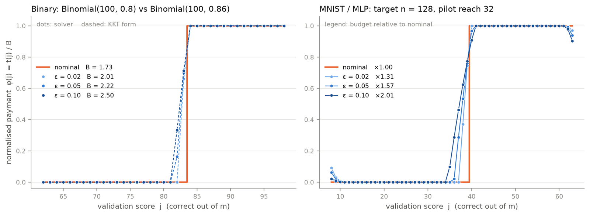
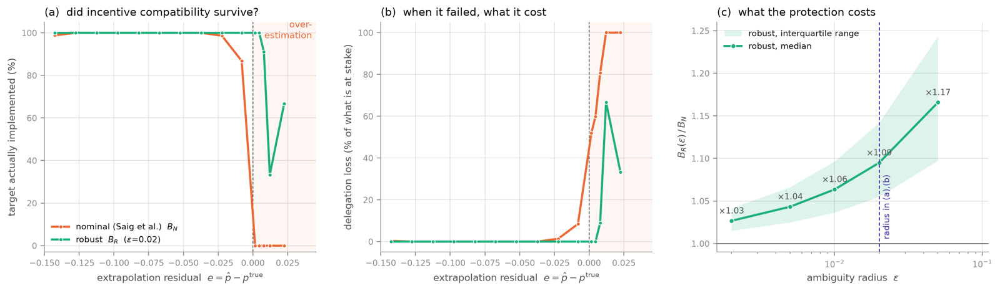

## Overview

Master's thesis at Saarland University (in progress), extending *Delegated Classification* by Saig, Talgam-Cohen and Rosenfeld (NeurIPS 2023).

A company (the **principal**) outsources the training of a classifier to an ML provider (the **agent**). The agent decides how much training data **n** to buy, at a cost, but the principal only receives the trained model. She cannot see n; she can only test the model on her own validation set of m points and observe the score **j** (the number of correct predictions). This is classical **moral hazard**: a hidden action that affects the other party.

The standard tool for moral hazard is a **contract**: one payment t(j) for every possible score j. The agent picks the n that maximises his expected payment minus his cost, and the principal wants to choose the payments so that this self-interested choice is the training-set size she actually wants.

## Motivation: uncertainty makes contracts fragile

The optimal contract is computed from the **outcome distributions**, i.e. how likely each score is under each action. In practice the principal never knows these distributions exactly. She has to estimate them from limited data, and any uncertainty in that estimate can make the contract fail.

The failure is not gradual. The optimal contract is a **threshold**: pay the full budget if the score is above a cut-off, otherwise pay nothing. If the principal's estimate is too optimistic, the threshold is set too high. Under the true distribution the agent can rarely pass it, his expected payment no longer covers his cost, and his best response **jumps to minimal effort**. The principal pays for a contract that delivers almost nothing.

What triggers this cliff is the **sign** of the error, not its size. Better estimators can make the error smaller but cannot guarantee that it is never optimistic. So instead of trying to estimate the distribution perfectly, the thesis designs a contract that **stays incentive-compatible for every distribution the truth could plausibly be**.

**Main case studied:** following Saig et al., the principal observes a small **pilot** learning curve and extrapolates it with a power law, E[accuracy(n)] = a − b·n^(−c), to the target size n\*, which lies beyond the pilot. In 6.8% of the instances tested, this extrapolation over-estimates the target accuracy, and the nominal contract fails in **every one** of them.

## From contracts to hypothesis tests

With two actions (low effort and the target n\*), the minimum-budget contract reduces to a linear program. Normalising the payments as t(j) = B·φ(j) with φ(j) ∈ [0, 1] shows that:

- φ is exactly a **randomised hypothesis test**: "pay" means "reject H₀: the agent took the low-effort action".
- Minimising the budget B is the same as minimising **type I + type II error** of that test.
- This is the Neyman–Pearson problem with threshold λ = 1, so the optimal contract is a **likelihood-ratio test**: pay whenever f₂(j) ≥ f₁(j).
- The minimum budget is **B\* = Δc / TV(f₁, f₂)**: the cost difference divided by the total variation distance between the two outcome distributions.

## The robust contract

The point estimate f̂ of the target distribution is replaced by an **ambiguity set**: all distributions within **KL divergence ε** of it. The incentive constraint must then hold against the **worst-case** distribution in that ball:

min ‖t‖∞ subject to min over q ∈ U_ε of ( E_q[t] − E_f₁[t] ) ≥ Δc

Setting ε = 0 gives back the original problem. KL was chosen because it compares probability distributions directly (the ball contains plausible distributions, not arbitrary perturbations) and its dual is tractable.

**Results of the analysis:**

- The inner worst case is solved with a Lagrangian. The least favourable distribution is an **exponential tilt** of the estimate, q\*(j) ∝ f̂(j)·e^(−φ(j)/η), and the dual is the **Donsker–Varadhan** formula, a one-dimensional problem in η.
- The optimality conditions give the shape of the robust contract: a **clipped log-likelihood-ratio ramp**

  φ\*(j) = clip to [0, 1] of ( η\*·log( f̂₂(j) / f₁(j) ) + C\* )

  The nominal step becomes a smooth ramp: the contract starts paying part of the budget just below the old threshold, because the worst case moves probability towards lower scores. The ramp widens as ε grows.

*Left: the numerical solver (dots) matches the analytical clipped log-likelihood ratio (dashed). Right: a real MNIST instance; budgets ×1.31, ×1.57 and ×2.01 of the nominal one.*

## Experiments

- **Data:** the Learning Curve Database (LCDB), MNIST with an MLP, exactly as in the original paper. An action is a training-set size n with cost n; the score is the number of correct predictions out of m = 100.
- **Pilot:** 12 pilot budgets between 50 and 3,000 samples, r ∈ {1, 3, 5} repetitions per size, a three-parameter power law fitted and extrapolated to a target 4× beyond the pilot (targets 128 to 2,896).
- **Scale:** 120 repetitions, **3,238 instances**, robust radius ε ∈ {0.002, 0.005, 0.01, 0.02, 0.05}.
- **Solver:** exponential-cone program in **CVXPY** (Clarabel, SCS fallback); every solution re-checked with the independent scalar dual.
- **Evaluation:** each contract is tested on the **true** problem with the authors' agent simulator, measuring implementation rate, delegation loss and the price of robustness B_R / B_N.

## Results

| ε | Instances inside the KL ball | Implemented there: nominal → robust | Over-estimated targets implemented | All instances implemented | Average loss | Budget ratio (median) |
|---|---|---|---|---|---|---|
| 0 (nominal) | — | — | 0.0% | 83.1% | 12.1% | 1.00 |
| 0.002 | 52 | 15.4% → **100%** | 24.1% | 87.1% | 10.6% | 1.03 |
| 0.005 | 140 | 23.6% → **100%** | 44.1% | 88.7% | 9.2% | 1.04 |
| 0.010 | 221 | 38.9% → **100%** | 62.7% | 90.0% | 7.8% | 1.06 |
| 0.020 | 337 | 46.3% → **100%** | 82.7% | 91.5% | 6.4% | 1.10 |
| 0.050 | 568 | 58.5% → **100%** | **95.0%** | **92.5%** | **5.5%** | 1.17 |

- Whenever the true distribution lies inside the KL ball, the robust contract implements the target **in 100% of cases**, as the theory guarantees.
- On over-estimated targets, where the nominal contract **always** fails, the robust contract succeeds in up to **95%** of cases.
- Average delegation loss drops from **12.1% to 5.5%**, for a median budget increase of only **3–17%**.

*(a) The nominal contract collapses as soon as the extrapolation over-estimates (e > 0); the robust contract (ε = 0.02) mostly holds. (b) The resulting loss in accuracy. (c) The budget cost of robustness.*

## Implementation

An extension of the authors' delegated-classification code, without modifying any original file: a robust contract designer (KL divergence, Donsker–Varadhan dual, minimum-budget robust contract, pilot-only radius calibration), an experiment runner that reuses the original sampler, learning curves and agent simulator, and plotting scripts for all figures.

## Next steps

Uncertainty is currently placed only on the extrapolated target distribution, while the low-effort actions, which lie inside the pilot range, are treated as known. Next: uncertainty across all actions, choosing ε from pilot data alone, and settings with more than two actions.
