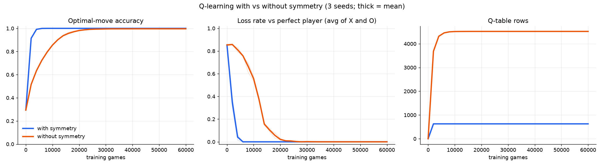
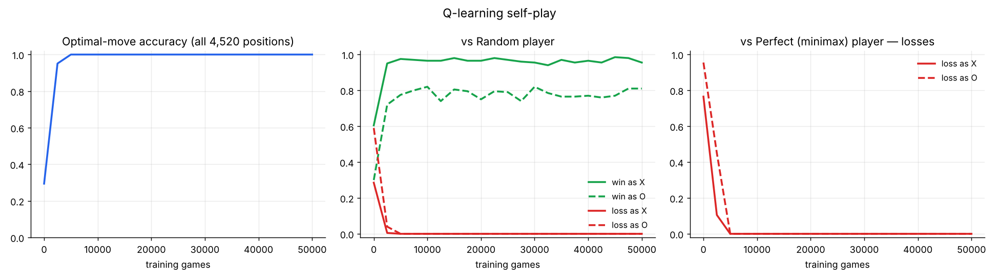

## Overview

An agent learns to play Tic-Tac-Toe **from scratch** with tabular **Q-learning** and **self-play**. It is never told what good play looks like: it only receives a reward at the end of each game (+1 for a win, 0 for a draw) and learns from that.

Tic-Tac-Toe is a solved game: with perfect play from both sides, every game is a draw. A perfect agent must therefore **never lose**, as X or as O, and **win whenever the opponent makes a mistake**. The goal was to let the agent discover this strategy on its own and to **measure honestly** whether it succeeded.

## Results

After about **5,000 training games (a few seconds on a laptop)** the agent plays perfectly. Final evaluation of the default model (50,000 games):

| Test | Result |
|---|---|
| Optimal move in every possible position (4,520 positions) | **100%** |
| vs perfect minimax player, 1,000 games as X and 1,000 as O | **0 losses** (all draws) |
| vs random player, 1,000 games as X | **96.9% wins**, 0 losses |
| vs random player, 1,000 games as O | **74.5% wins**, 0 losses |

Drawing every game against a perfect player is the best possible result in Tic-Tac-Toe. Winning less often as O is expected: moving second is harder, and many moves are equally safe draws, so the agent does not specially prefer the ones that trap a weak player.

## How it works

### Q-learning in its two-player ("negamax") form

The agent keeps a **Q-table** with a value Q(s, a) for every board s and move a (+1 = sure win, 0 = draw, −1 = sure loss), starting from all zeros. After each move it applies the update

Q(s, a) ← Q(s, a) + α · (target − Q(s, a))

Because the game is zero-sum, what is best for the opponent is worst for the agent, so the target is **+1** for a winning move, **0** for a drawing move, and otherwise **−γ · max Q(s′, a′)**, where s′ is the board seen from the opponent's side. The minus sign turns "the opponent's best value" into "my value". Every move gets a correct update straight away, without hand-crafted intermediate rewards.

### One table for both players

Before every lookup the board is multiplied by the player to move, so "my stones" are always +1 and the opponent's −1. The same table plays both X and O, and the agent learns from both sides of every game.

### Self-play training

- The agent plays **against itself**, choosing moves **ε-greedily**: a random move with probability ε, otherwise the move with the highest Q-value.
- After each game the moves are updated **from last to first**, so the result travels back through the whole game in a single pass.
- The target uses max, so learning is **off-policy**: random exploration moves do not corrupt the learned values.

| Parameter | Value |
|---|---|
| Learning rate α | 0.5 → 0.05 (linear decay) |
| Discount factor γ | 0.9: prefers fast wins and slow losses |
| Exploration rate ε | 1.0 → 0.05 over the first 70% of training |
| Training games | 50,000 by default (about 10 seconds) |

## Board symmetries: 6× faster learning

A square board has **8 symmetries** (4 rotations, each with or without a mirror flip), so many boards are the same position, only rotated. Before every Q-table lookup, all 8 versions of the board are generated, one fixed "standard" version is chosen, and the move is rotated the same way. All versions of a position then share **one row** of the Q-table, so something learned in one orientation is immediately known in all 8. The Q-learning formula itself does not change.

| (3 seeds each) | Games to 99% accuracy | Games to 0 losses vs perfect player | Q-table rows |
|---|---|---|---|
| **With symmetry** | **4,000** | **6,000** | **627** |
| Without symmetry | 24,000 | 27,333 | 4,520 |

Both versions learn perfect play; symmetry gets there **about 6× faster** with a **7× smaller table**.

## Evaluation method

The agent learns only from self-play, so self-play scores say little: when both sides improve together, the score stays near "all draws" whether the agent is weak or strong. Instead it is tested every 2,500 training games, playing greedily, against fixed examiners:

1. **Optimal-move accuracy**: for every one of the 4,520 non-terminal positions, are all the agent's preferred moves truly optimal?
2. **vs a perfect player**: games against a minimax player that never makes a mistake. Any loss reveals a real error.
3. **vs a random player**: checks that the agent actually **wins** when the opponent blunders.

The correct answers come from an exact **minimax solver**, used only for grading, never in training.

Accuracy starts at 29% (an empty table picks moves at random), reaches **95% after 2,500 games** and **100% after 5,000 games**, and stays there. Losses against the perfect player fall from 77% (as X) and 96% (as O) to **0%**.

## Web app

A browser version lets you play against the trained agent as X or O:

- a **Q-value heat map** on every empty cell, with a star on the agent's preferred move
- a bar chart of the agent's last decision
- an **"AI random moves" slider** (ε at play time): at 0% the agent is unbeatable, so raise it to give yourself a chance

The page does not learn; it reads the trained Q-table exported by the Python training code. It uses no innerHTML, sets a strict Content-Security-Policy and validates its data before use.

## Engineering

- Python package with commands for **train / evaluate / play / export**, ablation flags (no symmetry, online updates) and unit and end-to-end tests with pytest.
- Reproducible experiments with fixed seeds; results and figures are saved as CSV and PNG.
- Based on Sutton & Barto, *Reinforcement Learning: An Introduction* (Ch. 1 and 6.5), and work on symmetries in reinforcement learning (van der Pol et al., NeurIPS 2020).
